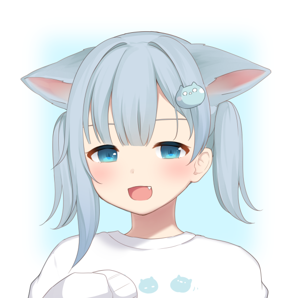

# RE:Amachiromaker · 安卓原生版

> 把被下线的捏脸网站 [RE:Amachiromaker](https://github.com/NekoQiye/RE-Amachiromaker)，
> 用 **Kotlin + Jetpack Compose** 重写成真正的安卓应用 —— 不是 WebView 套壳。

<p align="center">
  
</p>

**25 个部位 · 864 张可选贴图 · 1111 张贴图素材 · 600 × 600 输出 · 零网络请求**

在线预览与安装包下载：<https://gallery.shizuku.plus>

---

## 它和网页版有什么不同

| 环节 | 网页版 | 本仓库（原生版） |
|---|---|---|
| 界面 | React + HTML + CSS | Kotlin + Jetpack Compose |
| 叠图合成 | 浏览器 Canvas | `android.graphics.Canvas` → `Bitmap` |
| PSD 生成 | ag-psd（浏览器端） | 手写 PSD 编码器（纯 Kotlin，无第三方图像库） |
| 素材来源 | 随站点分发的图片 | 打包进 APK 的 `assets/`，离线可用 |
| 进度保存 | localStorage | SharedPreferences（键名沿用 `layerComb`） |
| 文件导出 | 浏览器下载 | MediaStore 相册 + 系统文件选择器（SAF） |
| 网络 | 首次加载需联网 | **不申请 INTERNET 权限** |

## 功能

- 25 个部位标签页（背景 / 后发 / 脸 / 腮红 / 双眼 / 高光 / 嘴 / 眉 / 表情 / 兽耳 / 衣服 / 刘海 / 侧发 / 发饰 …）
- 贴图网格、空槽（「无」）、按部位的多套配色色板
- 实时合成预览（600 × 600）
- **保存 PNG** → 写入相册 `Pictures/Amachiromaker/`
- **保存 PSD** → 每个部位一个独立图层（含图层名与坐标），Photoshop / Krita / GIMP / Photopea 可继续编辑
- 重置、预设导入导出（与网页版 JSON 格式完全互通）
- 日间 / 夜间主题
- 所有进度本地持久化

## 目录结构

```
.
├── android/                  安卓工程（Kotlin + Compose）
│   ├── app/src/main/java/cc/nekoha/amachiromaker/
│   │   ├── MainActivity.kt
│   │   ├── model/Models.kt            数据模型（kotlinx.serialization）
│   │   ├── data/AssetStore.kt         assets 读取 + Bitmap LRU 缓存
│   │   ├── data/MakerState.kt         组合状态、持久化、预览调度
│   │   ├── render/Compositor.kt       600×600 分层合成
│   │   ├── export/PsdWriter.kt        纯 Kotlin 分层 PSD 写出
│   │   ├── export/Exports.kt          MediaStore / SAF 文件读写
│   │   └── ui/                        主题、主界面、部位选择组件
│   └── app/src/main/assets/data/      orderedLayers.json / defaultCombination.json
├── website/                  静态展示站（原生 HTML + CSS + JS，Font Awesome 自托管）
└── docs/                     使用说明与构建笔记
```

## 构建安卓应用

需要 JDK 17 与 Android SDK（compileSdk 34）：

```bash
cd android
./gradlew :app:assembleDebug        # 或 :app:assembleRelease
```

> 发布用签名在 `app/build.gradle.kts` 的 `signingConfigs` 中配置，示例指向 `keystore/local.jks`；
> 换成你自己的签名文件即可（**不要把私钥提交到仓库**）。

### 素材说明

`android/app/src/main/assets/image_maker/` 下的 1111 张贴图（约 32 MB）**没有纳入本仓库，也不在任何发行附件里**：
图片版权归画师所有，单独打包再分发并不合适，体积也较大。

缺失素材时应用仍可启动，只是画面是空白的。需要的同学请从上游项目自行获取：

- [NekoQiye/RE-Amachiromaker](https://github.com/NekoQiye/RE-Amachiromaker) → `app/image_maker/`

目录结构需要保持为 `assets/image_maker/168503/<部位ID>/<i_*.png|ii_*.png|p_*.png>`。

## 部署展示站

`website/` 是纯静态站点，直接把整个目录丢给任意静态服务器即可：

```bash
python -m http.server 8090 --directory website
```

站内含「多源智能下载」：前端并行拉取各节点的 `/speedtest.bin` 样本测速，自动从最快节点下载，
并把最快节点记在浏览器本地。想加节点，改 `website/assets/js/app.js` 顶部的 `MIRRORS` 数组即可
（节点侧需要提供一份 512 KB 的 `speedtest.bin`，并带上 `Access-Control-Allow-Origin: *`）。

## 下载

预编译 APK 见 [Releases](../../releases) 页面；也可以直接访问 <https://gallery.shizuku.plus> 下载（自带多节点测速选优）。

## 版权与致谢

- 贴图版权归 **甘城なつき**（[amashiro.com](https://amashiro.com/)）所有，**请勿商用或二次售卖**。
- 上游二改项目：[NekoQiye/RE-Amachiromaker](https://github.com/NekoQiye/RE-Amachiromaker)（作者 祈烨猫猫，MIT）。
- 原始项目：Charlie Chiangm 的 amachiromaker。
- 本仓库为安卓原生移植版，遵循 MIT 许可；二次修改请保留上述署名与原项目地址。

> 本项目为非商业同人作品，与原始作者、画师无隶属关系。
